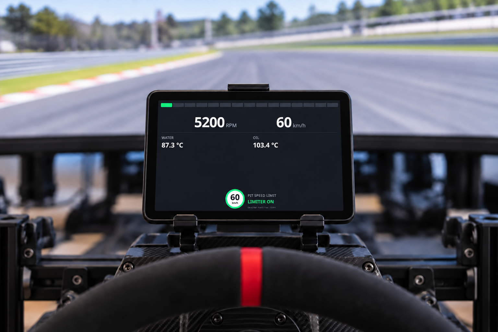
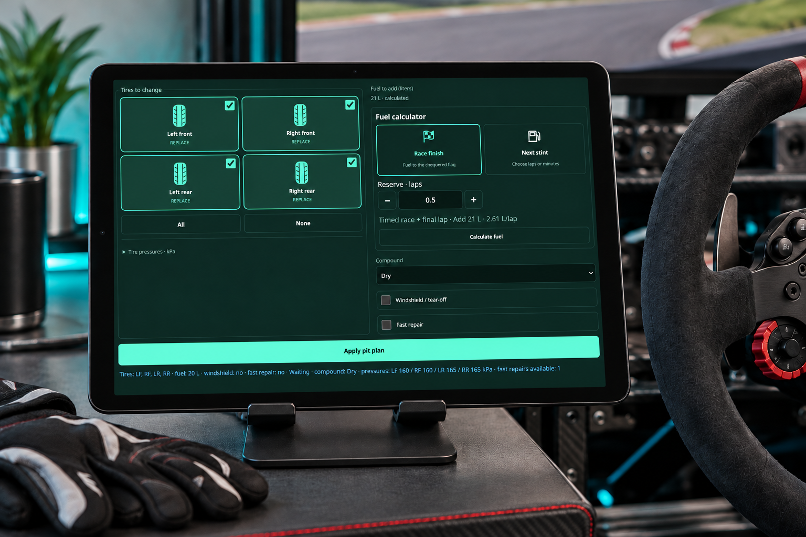
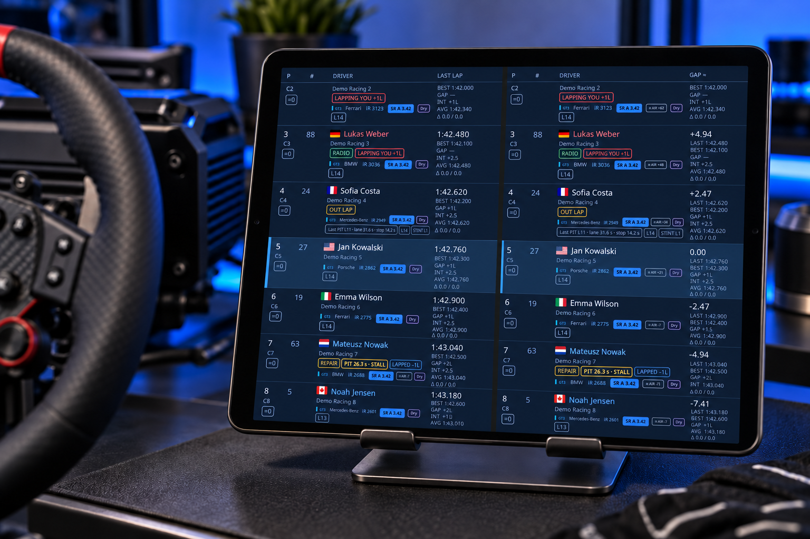
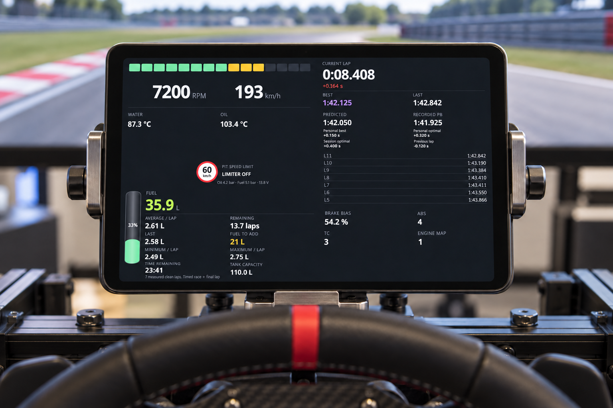
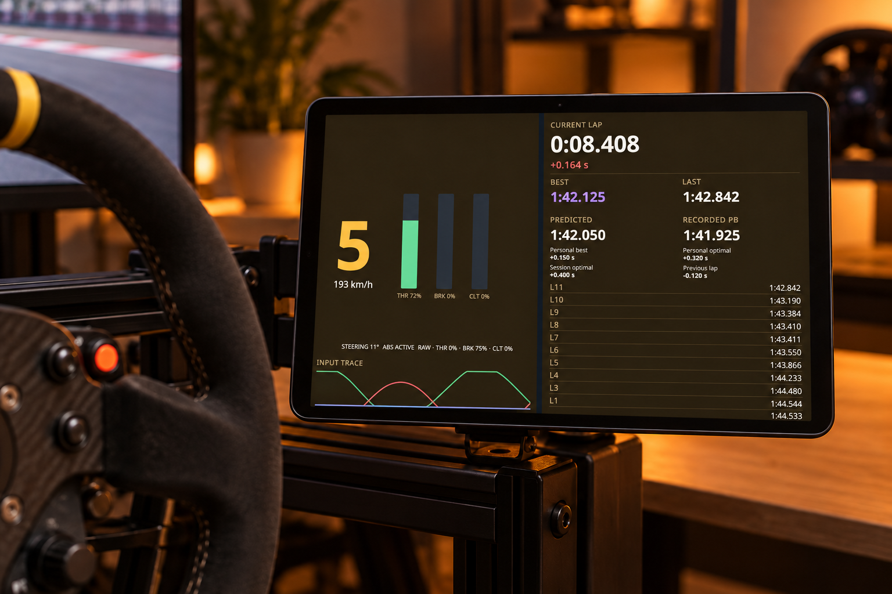
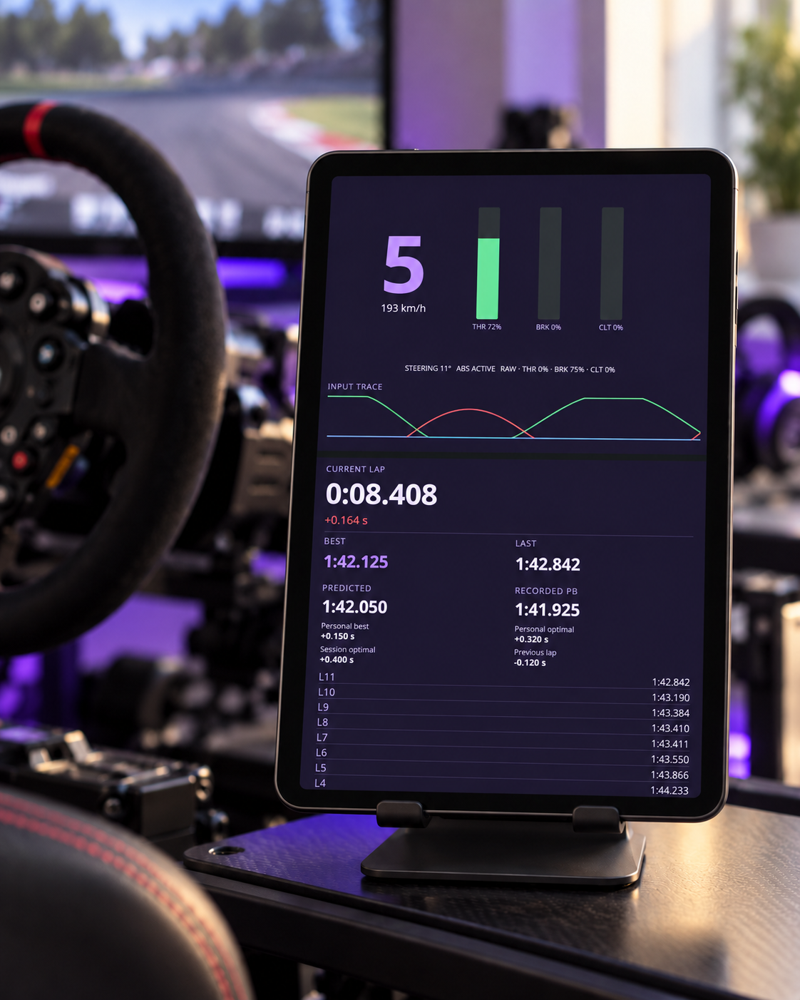
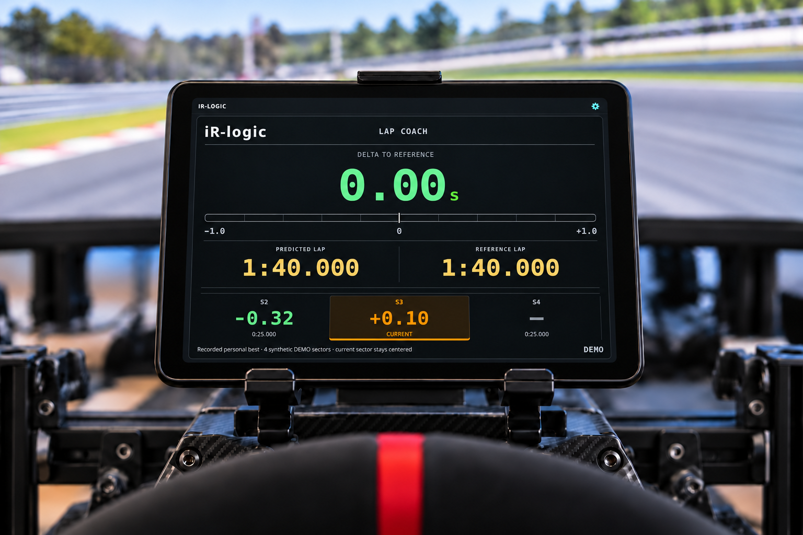

# iR-Board

A customizable iRacing dashboard for tablets on your private local network.

**Version v1.0.0 · First release · Windows · MIT License**

## Tablet dashboard

Generated tablet mockups showing iR-Board in fullscreen mode with simulated DEMO telemetry. Hardware and backgrounds are illustrative. Click an image to view it at full size.

| Speed, RPM and PIT limiter | PIT service plan |
| :---: | :---: |
| [](docs/images/tablet-01-speed-rpm.png) | [](docs/images/tablet-03-pit.png) |

| Centered Standings / Relative, lapping and PIT status | Four-widget overview |
| :---: | :---: |
| [](docs/images/tablet-02-race.png) | [](docs/images/tablet-06-overview.png) |

| Driving inputs and lap timing | Portrait tablet layout |
| :---: | :---: |
| [](docs/images/tablet-04-driving.png) | [](docs/images/tablet-05-portrait.png) |

## iR-logic

**iR-logic** works in live sessions and DEMO. The generated tablet mockup uses simulated DEMO telemetry; hardware and background are illustrative.

[](docs/images/tablet-07-irlogic.png)

iR-logic shows live lap delta, predicted lap time and selectable clean-lap references. Its automatic carousel follows the SDK sector count and keeps the current sector centered. Completed sectors show gains in green and losses in red; the current sector is orange. Unmeasured sectors remain neutral.

iR-logic is included on the seventh default page and is also available using **Add widget**. Complete a continuous clean lap to record references; personal-best references are saved locally for the car and track. Sector comparisons require SDK sector boundaries.

## Install

1. Download the Windows setup EXE from [Releases](https://github.com/KarquGit/ir-board/releases).
2. Install and launch iR-Board on the computer running iRacing.
3. Connect your tablet to the same private network.
4. Scan the QR shown on the computer, or open its displayed address and enter the six-digit code.

The computer running iR-Board does not require pairing. Keep its desktop window open while using the dashboard.

If the tablet cannot connect, use **Allow tablet access through Windows Firewall** and set your trusted home network to **Private**.

## Features

- Seven default dashboard pages with customizable widget positions, sizes, colors and visibility.
- Thirty themes and a custom palette editor.
- Speed, RPM, configurable shift indicators, gear and driving inputs.
- Standings, Relative and lap timing.
- Car-aware tire compound names.
- Fuel estimates based on measured consumption, with saved car/track measurements clearly marked as historical after restart.
- PIT service planning with explicit **Apply pit plan**.
- Pit-speed indication based on SDK pit approach and pit-road state.
- Learned track map (Experimental), recorded locally from telemetry.
- Layout synchronization between paired devices, plus import and export.
- Update checks with installation deferred until you finish driving.

The seven default pages contain: Tachometer; Relative + Learned track map; Fuel + Car systems + Inputs and gear + Lap timing; Standings; Learned track map; Pit stop; and iR-logic.

Saved layouts are preserved across restarts and installation updates. Page navigation remains independent on each device. To apply the supplied dashboard to an existing installation, import [docs/default-layout.json](docs/default-layout.json) in settings. This replaces the layout only when you choose to import it.

## Pairing and LAN access

Remote devices must pair before accessing the dashboard, telemetry or settings.

QR credentials and six-digit codes are single-use and expire after five minutes. The numeric code refreshes after use or expiry. Device sessions expire after 12 hours or when the server restarts. Pairing attempts are rate-limited.

This version uses HTTP. Pairing controls access but does not encrypt traffic. Use a trusted private LAN and do not expose the server to the Internet.

## Fuel and PIT services

Complete a full clean on-track lap after crossing the start line to measure consumption.

In Practice, choose **Next stint** and specify laps or minutes. **Race finish** requires a Race session.

Fuel calculations are estimates. Only **Apply pit plan** sends the proposed services to iRacing. Availability depends on the car and session.

## Run from source on Windows

Install Python 3.12 with Tcl/Tk support, then run:

    py -3.12 -m venv .venv
    .\.venv\Scripts\python.exe -m pip install -r requirements.txt
    .\.venv\Scripts\python.exe launcher.py

## Test DEMO mode

DEMO does not require iRacing.

Installed Windows EXE, in PowerShell:

```powershell
& "$env:LOCALAPPDATA\Programs\iR-Board\iR-Board.exe" --demo
```

From source on Windows:

```powershell
py -3.12 -m venv .venv
.\.venv\Scripts\python.exe -m pip install -r requirements.txt
.\.venv\Scripts\python.exe server.py --demo --host 0.0.0.0 --port 8000
```

From source on Linux:

```sh
python3 -m venv .venv
.venv/bin/python -m pip install -r requirements.txt
.venv/bin/python server.py --demo --host 0.0.0.0 --port 8000
```

Open http://localhost:8000 for the application and http://localhost:8000/connect for tablet pairing. Open the displayed LAN address on the tablet. Stop a terminal server with **Ctrl+C**.

## Documentation

- [LAN access and pairing](docs/LAN_SECURITY.md)
- [Windows security and installer checks](docs/WINDOWS_SECURITY.md)
- [iRacing SDK compatibility](docs/SDK_COMPATIBILITY.md)

The Windows installer is unsigned. Releases include a SHA-256 checksum.

## License

MIT — see [LICENSE](LICENSE).
Dependency notices: [THIRD_PARTY_NOTICES.md](THIRD_PARTY_NOTICES.md).

This project is independent of iRacing.
